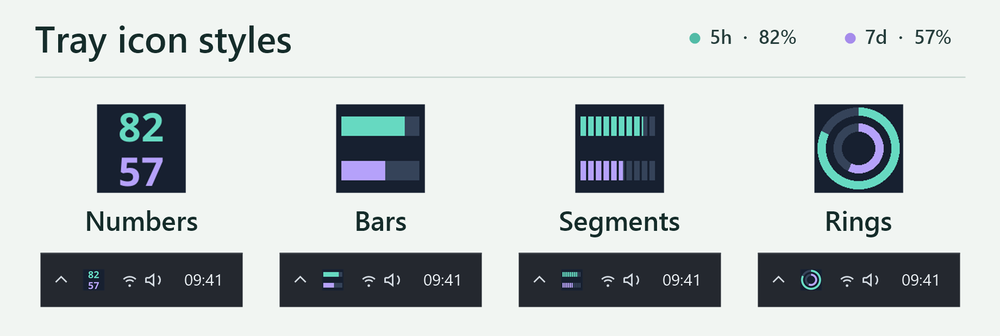

# Codex Limit Tray

[Russian](README.ru.md)

**Track your Codex usage limits in the Windows system tray.** The tray icon shows your remaining quota; open it to see when your five-hour and weekly limits reset, or keep a small widget above your windows.

**[Download for Windows · x64 installer](https://github.com/DmiAlexPRO/codex-limit-tray/releases/latest/download/CodexLimitTray-windows-x64-Setup.exe)** · [All releases and portable downloads](https://github.com/DmiAlexPRO/codex-limit-tray/releases)

Downloads across all GitHub releases:

[](https://github.com/DmiAlexPRO/codex-limit-tray/releases)
[](https://github.com/DmiAlexPRO/codex-limit-tray/releases)
[](https://github.com/DmiAlexPRO/codex-limit-tray/releases)
[](https://github.com/DmiAlexPRO/codex-limit-tray/releases)

Free under the [MIT License](LICENSE). Requires a local Codex installation signed in to a supported ChatGPT subscription. This independent project is not affiliated with OpenAI; it shows **Codex subscription quotas**, not general ChatGPT limits or API spending.



The app has **20 interface languages**. It uses a supported system language on installation or first launch and falls back to English. To choose another language, open the gear → **Appearance → Language**, select it, and restart Codex Limit Tray. [Supported languages](docs/releases/v3.1.0.md#languages).


To change the tray icon, open the gear → **Appearance → Icon** and choose **Numbers**, **Bars**, **Segments** or **Rings**.

## Start on Windows

1. Install Codex and sign in through Codex desktop or `codex login`. There are no extra accounts or API keys for the tray app.
2. Download and run **CodexLimitTray-windows-x64-Setup.exe**. It installs for your Windows user, without administrator privileges. The installer does **not** have an Authenticode publisher signature; Windows may show a SmartScreen warning. Get the installer only from this repository's releases.
3. Open **Codex Limit Tray**. Close its window to leave the icon in the tray; click the icon to bring the window back. If Codex isn't found, open the gear → **Connection** and enter the full path to the trusted Codex executable.

The download button follows the latest **stable Windows release**, not previews. See the [3.0.1 release notes](docs/releases/v3.0.1.md) for the update policy and platform limits.

## Which download should I use?

| Edition | Choose it if… | How it updates |
| --- | --- | --- |
| **Windows x64 · Setup** | You want a Start menu entry and updates without reinstalling by hand. | The stable edition checks for stable releases at startup by default; verifies a newer installer, installs it and restarts in the tray. You can switch to manual checks. |
| **Windows x64 · portable ZIP** | You want to run the EXE from a folder without installing. | No automatic check or installation. Replace the portable copy yourself, or explicitly choose to install the normal edition. Your settings carry over. |
| **macOS · experimental** | You want to try the app on Apple Silicon (`arm64`) or Intel (`x86_64`). Choose the matching ZIP when available. | Unzip the `.app` and install or replace it manually. In-app checks show release notes only. Bundles are unsigned and not notarized; real-hardware acceptance is pending. |

In **Settings → Updates**, read what changed, check manually, or turn off **Automatically install updates on startup**. With auto-update off, there is no startup check. **Refresh limits** on the main screen only refreshes your quota. In-app installer updates are checked against an embedded Ed25519 public key; this does not authenticate your first download. See [how updates are verified](docs/UPDATES.md).

## Using the tray and widget

- Hover over the tray icon for both percentages. Open **Widget** for an always-on-top view; right-click the widget to hide it.
- In **Appearance**, choose a theme, tray indicator style, low-quota color and optional Windows sound. To start in the tray at login, enable **Start at login**.
- The dashboard shows only the quota windows Codex returns. If a request fails, the app shows the error instead of presenting old numbers as current.

## What leaves my computer?

Codex Limit Tray starts your local `codex app-server` and reads `account/rateLimits/read`. Codex handles authentication; the tray app never reads credential files. Successful polls run every 30 seconds; failures back off to five minutes. Each poll currently starts a short-lived app-server process.

The app has **no analytics** and does not save quota values. Update checks contact GitHub without sending Codex credentials, account details or quota values. Preferences live in `CodexLimitTray/fyne-preview.json` under `%APPDATA%` (Windows) or `~/Library/Application Support` (macOS). Diagnostic paths may contain your username; redact them before sharing. See [Security](SECURITY.md).

## Build or try a demo

The application is written in Go and Fyne, with no WebView. Use Go 1.26+ and a CGO-compatible toolchain. On Windows you need MinGW/GCC with `windres` and PowerShell:

```powershell
.\build.ps1 -Preview
.\dist\CodexLimitTray.exe --demo
```

On macOS, install Xcode Command Line Tools and build on the target architecture:

```sh
sh scripts/build-macos.sh
open dist/CodexLimitTray.app --args --demo
```

`--demo` uses sample quotas without connecting to Codex or GitHub or saving settings. `--minimized` starts the app in the tray. The build scripts run `go test ./...` and `go vet ./...`. For installer builds, signing and release checks, see [Releasing](docs/RELEASING.md).

[Changelog](CHANGELOG.md) · [Contributing](CONTRIBUTING.md) · [Third-party notices](THIRD_PARTY_NOTICES.txt)
