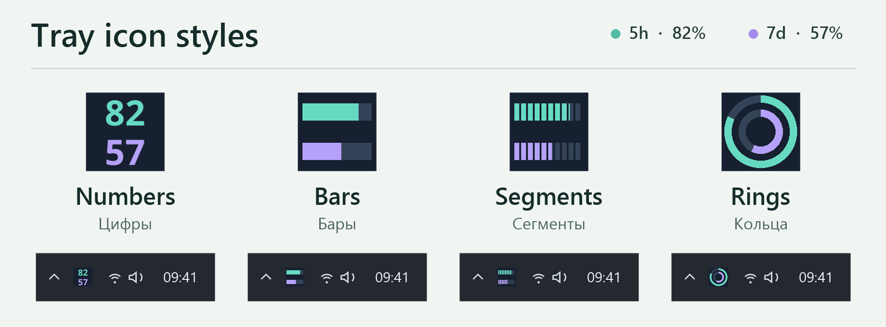
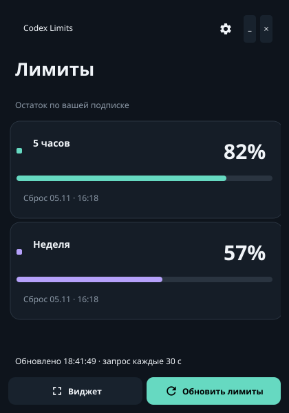
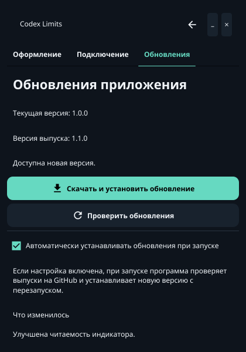
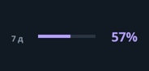

# Codex Limit Tray

[English](README.md)

**Проверяйте лимиты Codex в трее Windows — на значке виден остаток в процентах.** Нажмите на него, чтобы посмотреть остаток и время сброса для пятичасового и недельного лимитов, или оставьте компактный виджет поверх рабочих окон.

**[Скачать для Windows · установщик x64](https://github.com/DmiAlexPRO/codex-limit-tray/releases/latest/download/CodexLimitTray-windows-x64-Setup.exe)** · [Все выпуски и переносные версии](https://github.com/DmiAlexPRO/codex-limit-tray/releases)

Скачивания за все выпуски на GitHub:

[](https://github.com/DmiAlexPRO/codex-limit-tray/releases)
[](https://github.com/DmiAlexPRO/codex-limit-tray/releases)
[](https://github.com/DmiAlexPRO/codex-limit-tray/releases)
[](https://github.com/DmiAlexPRO/codex-limit-tray/releases)

Бесплатный инструмент с открытым кодом под [лицензией MIT](LICENSE). Нужен установленный Codex со входом через поддерживаемую подписку ChatGPT. Проект независимый и не связан с OpenAI: он показывает **лимиты подписки Codex**, а не общие лимиты ChatGPT и не расходы на API.



Интерфейс доступен на **27 языках**, в том числе на русском и английском. При установке или первом запуске приложение выбирает поддерживаемый язык системы. Если подходящего языка нет, используется английский. Чтобы сменить язык, нажмите шестерёнку → **Оформление → Язык** и перезапустите приложение.


Чтобы изменить значок в трее, нажмите шестерёнку → **Оформление → Значок** и выберите **Цифры**, **Бары**, **Сегменты** или **Кольца**.



## Первый запуск в Windows

1. Установите Codex и войдите в аккаунт через Codex desktop или команду `codex login`. Отдельный аккаунт и API-ключ для утилиты не нужны.
2. Скачайте и запустите **CodexLimitTray-windows-x64-Setup.exe**. Программа установится для текущего пользователя без прав администратора. У установщика нет подписи издателя Windows (Authenticode), поэтому SmartScreen может показать предупреждение. Скачивайте его только из релизов этого репозитория.
3. Откройте **Codex Limit Tray**. Крестик прячет окно в трей; щелчок по значку возвращает его на экран. Если Codex не найден, нажмите шестерёнку → **Подключение** и введите полный путь к доверенному исполняемому файлу Codex.

Кнопка скачивания ведёт на последний **стабильный выпуск для Windows**, а не на предварительную сборку. Об обновлениях и ограничениях платформ — в [заметках к версии 3.0.1](docs/releases/v3.0.1.md).

## Какую версию выбрать?

| Вариант | Кому подойдёт | Обновления |
| --- | --- | --- |
| **Windows x64 · установщик** | Нужен ярлык в меню «Пуск» и обновление без ручной переустановки. | Стабильная версия по умолчанию проверяет при запуске только стабильные выпуски. Если вышла новая версия, проверяет подпись установщика, устанавливает обновление и возвращается в трей. Можно переключиться на ручную проверку. |
| **Windows x64 · переносной ZIP** | Удобнее распаковать EXE в свою папку и работать без установки. | Сам ничего не проверяет и не устанавливает. Можно заменить EXE вручную или явно выбрать установку обычной версии. Настройки сохранятся. |
| **macOS · экспериментально** | Для Apple Silicon выбирайте ZIP с пометкой `arm64`, для Intel — `x86_64`, если архив опубликован. | Распакуйте и установите или замените `.app` вручную. В приложении доступны проверка версии и описание релиза. Сборки без подписи и нотариального заверения Apple; проверка на реальных Mac ещё не завершена. |

В разделе **Настройки → Обновления** можно посмотреть, что изменилось, проверить наличие новой версии или отключить автоустановку. Если её выключить, при запуске не будет и проверки. Кнопка **Обновить лимиты** на главном экране обновляет только данные аккаунта. Перед установкой из приложения проверяется подпись Ed25519; она не удостоверяет подлинность первого скачанного EXE. [Подробнее об обновлениях](docs/UPDATES.md).



## Трей и виджет

- Наведите курсор на значок в трее, чтобы увидеть оба процента. Нажмите **Виджет**, чтобы оставить индикатор поверх окон; щелчок правой кнопкой по виджету скрывает его.
- В разделе **Оформление** можно выбрать тему, стиль значка и цвет низкого остатка, а в Windows — включить звуковой сигнал. Настройка **Запускать при входе в систему** открывает программу сразу в трее.
- Утилита показывает только те лимиты, которые вернул Codex. При неудачном запросе она покажет причину, а не устаревшие проценты.



## Какие данные передаются?

Утилита запускает локальный `codex app-server` и вызывает `account/rateLimits/read`. За авторизацию отвечает сам Codex; утилита не читает файлы токенов. Лимиты проверяются каждые 30 секунд; при ошибках пауза увеличивается до пяти минут. На каждый запрос пока запускается отдельный короткоживущий процесс.

**Аналитики нет**, история лимитов не сохраняется. При проверке обновлений программа обращается к GitHub, но не отправляет ему учётные данные Codex, сведения об аккаунте или значения лимитов. Настройки лежат в `CodexLimitTray/fyne-preview.json` внутри `%APPDATA%` в Windows или `~/Library/Application Support` в macOS. Путь в диагностике может содержать имя пользователя — скройте его перед публикацией. [Безопасность](SECURITY.md).

## Сборка и деморежим

Программа написана на Go и Fyne, без WebView. Нужны Go 1.26+ и компилятор с поддержкой CGO. В Windows потребуются MinGW/GCC с `windres` и PowerShell:

```powershell
.\build.ps1 -Preview
.\dist\CodexLimitTray.exe --demo
```

В macOS установите Xcode Command Line Tools и выполните на Mac нужной архитектуры:

```sh
sh scripts/build-macos.sh
open dist/CodexLimitTray.app --args --demo
```

`--demo` показывает пример без подключения к Codex и GitHub и без сохранения настроек. `--minimized` запускает программу в трее. Скрипты сборки выполняют `go test ./...` и `go vet ./...`. Как собрать установщик, подписать и проверить релиз — в [руководстве по выпуску](docs/RELEASING.md).

[История изменений](CHANGELOG.md) · [Как помочь проекту](CONTRIBUTING.md) · [Сторонние компоненты](THIRD_PARTY_NOTICES.txt)
